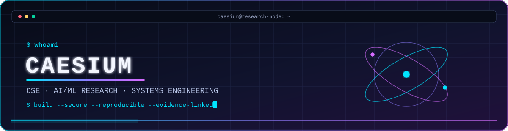
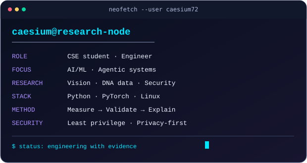
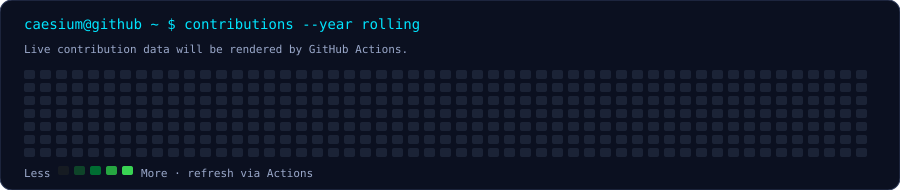

<!--
  CAESIUM / MD. FAZLAY RABBI
  Animated profile README.
  Motion is implemented inside local SVG assets; no JavaScript is embedded here.
-->

<div align="center">



<p>
  <a href="https://caesium.dpdns.org"></a>
  <a href="https://github.com/caesium72"></a>
  <a href="https://www.linkedin.com/in/md-fazlay-rabbi-240184263/"></a>
</p>

**Computer Science & Engineering · AI/ML Research · Agentic Systems · Security Engineering**

<sub><code>boot sequence: research → model → engineer → evaluate → publish</code></sub>

</div>

---

## `whoami`



I'm **MD. Fazlay Rabbi**, a CSE student and engineer interested in building systems that are measurable, explainable, and secure.

- Researching **AI/ML, computer vision, data analytics, and computational biology**.
- Building **agentic systems** with explicit tool boundaries, evidence trails, and reliable execution.
- Exploring **blockchain payment security**, protocol composition, and verifiable settlement.
- Prefer reproducible experiments, honest baselines, and engineering over benchmark theater.
- Portfolio: **[caesium.dpdns.org](https://caesium.dpdns.org)**

<br clear="right"/>

## `research --active`

### 01 · Compositional security for agentic commerce

**CLB-ACEL — Cross-Layer Binding, Predicate-Constrained Settlement, and Evidence-Linked Verification in AI-Agent Payments**

Research on binding identity, mandate, and settlement intent across agentic payment layers. The design uses an EIP-712 commitment, nonce-derived freshness, and evidence traces anchored through a Merkle root. The paper has been **accepted in Engineering Reports**.

```text
Agent identity + mandate + settlement descriptor
                    │
                    ▼
          Commitment / EIP-712
                    │
                    ▼
       Predicate checks + nonce freshness
                    │
                    ▼
        Evidence trace → Merkle root
                    │
                    ▼
            Blockchain audit anchor
```

Focus: identity binding · authorization integrity · replay resistance · non-transferability · predicate soundness.

### 02 · DNA Sequence Quality Index (DSQI)

A data-driven quality-index pipeline for DNA storage sequences, combining sequence composition, homopolymer characteristics, entropy, and k-mer-derived features with tree-based and statistical models.

```text
DNA sequences → feature extraction → DSQI (0–100)
                                  ├─ GC / homopolymer
                                  ├─ entropy / k-mers
                                  └─ model analysis + SHAP
```

Research priorities: leakage-safe validation, external dataset generalization, feature stability, and transparent uncertainty reporting.

### 03 · Fine-grained fruit and vegetable quality assessment

Computer-vision research combining detection, classification, and segmentation ideas for unripe, ripe, and rotten produce. Explored EfficientNetV2, ConvNeXt, DeiT, Swin Transformer, YOLO, and segmentation workflows.

**Engineering focus:** defensible splits, cross-validation, class-wise metrics, segmentation-specific evaluation, and avoiding inflated results from whole-image pseudo-boxes.

### 04 · Provenance-aware blockchain infrastructure benchmark

A hybrid benchmark concept for matching transaction intents to blockchain and payment infrastructure using source provenance, protocol constraints, and auditable decision features. The next iteration prioritizes record-level evidence, explicit uncertainty, and a clear separation between observed and modeled data.

---

## `systems --building`

<table>
<tr>
<td width="50%" valign="top">

### Agentic AI
- Tool-using assistants and orchestration
- Evidence-linked workflows
- Memory and state management
- Guardrails and failure handling

</td>
<td width="50%" valign="top">

### ML & computer vision
- PyTorch / Torchvision / timm
- OpenCV and Ultralytics YOLO
- Reproducible evaluation pipelines
- Explainability and data quality

</td>
</tr>
<tr>
<td width="50%" valign="top">

### Data & computational research
- Python, NumPy, pandas, scikit-learn
- Statistical validation and feature engineering
- DNA sequence analytics
- Spark / PySpark exploration

</td>
<td width="50%" valign="top">

### Security & infrastructure
- Linux, Git, Docker, GitHub Actions
- Blockchain protocol composition
- Privacy-by-design and least privilege
- API boundaries and auditability

</td>
</tr>
</table>

## `stack --inventory`

**Languages**  


**AI / ML / Research**  


**Engineering / Infrastructure**  


## `activity --contributions`

<div align="center">



<sub>The graph is generated from GitHub's public contribution calendar. It is not a productivity or research-quality metric.</sub>

</div>

## `principles.md`

- **Reproducibility:** pin dependencies where practical, document assumptions, preserve split integrity.
- **Security:** least privilege, minimal permissions, no secrets in source, and no unnecessary external runtime dependencies.
- **Evidence:** distinguish measured observations from modeled values and hypotheses.
- **Evaluation:** report baselines, class-wise metrics, uncertainty, and limitations—not only the best score.
- **Privacy:** do not publish credentials, private datasets, or sensitive operational details in profile assets.

## `connect --open`

- Website: [caesium.dpdns.org](https://caesium.dpdns.org)
- GitHub: [@caesium72](https://github.com/caesium72)
- LinkedIn: [MD. Fazlay Rabbi](https://www.linkedin.com/in/md-fazlay-rabbi-240184263/)

<div align="center">

<sub><code>exit 0</code> · Built with research, engineering, and a terminal-first mindset.</sub>

</div>
